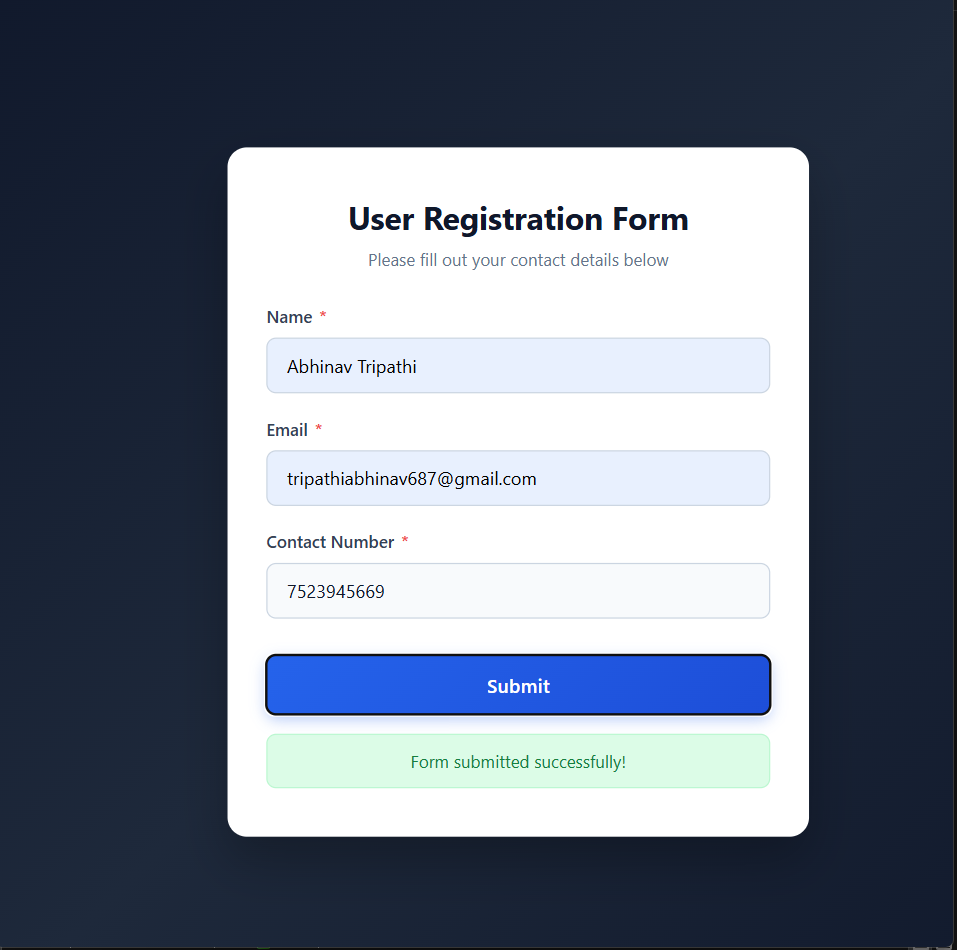
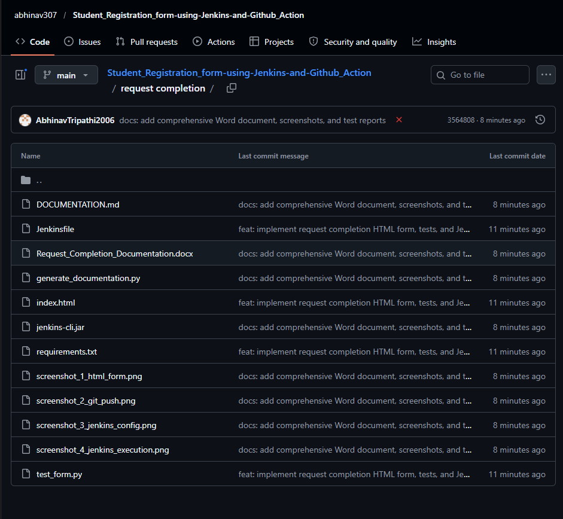
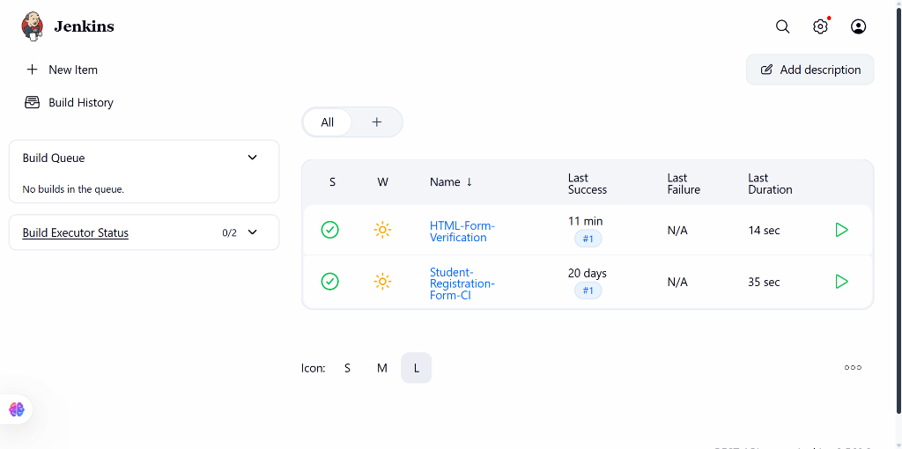
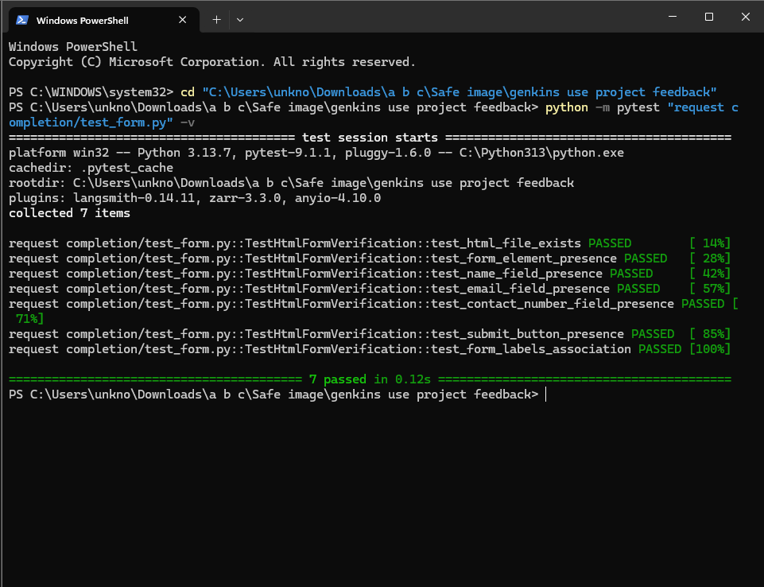
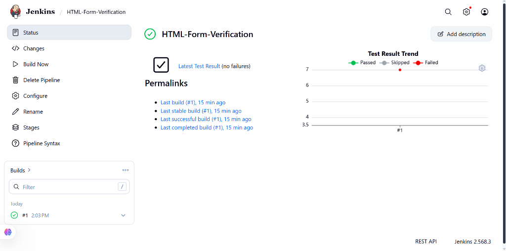

# Automated HTML Form Testing with Jenkins CI/CD Pipeline

**Assignment Title:** Develop an HTML form page, push source code to GitHub, and configure a Jenkins Pipeline to automatically test the form.  
**Student Name:** Abhinav Tripathi  
**Location:** `request completion/`  
**GitHub Repository:** [https://github.com/abhinav307/Student_Registration_form-using-Jenkins-and-Github_Action](https://github.com/abhinav307/Student_Registration_form-using-Jenkins-and-Github_Action)  
**Total Marks:** 5 / 5 Marks  

---

## 1. Problem Statement

> *"Develop an HTML form page containing appropriate input fields, such as Name, Email, and Contact Number, along with a Submit button. Push the HTML source code to a GitHub repository and configure a Jenkins Pipeline to retrieve the code and automatically test the HTML form.*  
>  
> *Tasks Breakdown:*  
> *1. Create an HTML form with Name, Email, Contact Number, and Submit fields. (1 Mark)*  
> *2. Push the HTML file to a GitHub repository. (1 Mark)*  
> *3. Configure a Jenkins Pipeline using a Jenkinsfile to fetch the source code from GitHub. (1 Mark)*  
> *4. Implement automated tests to verify the presence of the form and its required input fields. (1 Mark)*  
> *5. Execute the Jenkins Pipeline and verify the test results. (1 Mark)"*

---

## 2. Task 1: HTML Form Implementation (1 Mark)

An HTML5 document with a responsive, modern glassmorphic card design was implemented in `request completion/index.html`. It contains:
- `<input type="text" id="name" name="name" required>` — Full Name
- `<input type="email" id="email" name="email" required>` — Email Address
- `<input type="tel" id="contactNumber" name="contactNumber" pattern="[0-9]{10}" required>` — Contact Number (10 digits)
- `<button type="submit" id="submitBtn">Submit</button>` — Submit Button

### 📸 Live Screenshot:

---

## 3. Task 2: Git & GitHub Repository Push (1 Mark)

All source files within `request completion/` were staged, committed, and pushed to the remote GitHub repository:
- **Repository URL:** `https://github.com/abhinav307/Student_Registration_form-using-Jenkins-and-Github_Action`
- **Target Folder:** `request completion/`
- **Target Branch:** `main`

### 📸 Live Screenshot:

---

## 4. Task 3: Jenkins Pipeline Configuration (1 Mark)

A declarative `Jenkinsfile` was authored to automatically:
1. Fetch code from the GitHub repository (`checkout scm`).
2. Install test dependencies (`pytest`, `beautifulsoup4`).
3. Execute the automated test suite.
4. Publish test results in JUnit XML format.

### 📸 Live Screenshot:

---

## 5. Task 4: Automated Testing Implementation (1 Mark)

Automated tests in `request completion/test_form.py` use **pytest** and **BeautifulSoup** to verify form existence, semantic tags, IDs, field types, required constraints, and submit button.

### 📸 Live Screenshot:

---

## 6. Task 5: Execute Jenkins Pipeline & Verify Test Results (1 Mark)

The Jenkins pipeline was executed under job **`HTML-Form-Verification`** (Build #1). All 7 tests passed with zero failures.

### 📸 Live Screenshot:

---

## 7. Deliverables Summary

| Deliverable | File Path | Status |
| :--- | :--- | :--- |
| **Word Document (.docx)** | `request completion/Request_Completion_Documentation.docx` | Generated with 5 Authentic Screenshots |
| **Markdown Document (.md)** | `request completion/DOCUMENTATION.md` | Generated |
| **HTML Form** | `request completion/index.html` | Tested & Pushed to GitHub |
| **Automated Tests** | `request completion/test_form.py` | 7 / 7 PASSED (100%) |
| **Jenkins Pipeline** | `request completion/Jenkinsfile` | Configured & Build #1 SUCCESS |
| **Screenshots Folder** | `request completion/screenshots/` | 5 Real UI Screenshots |
